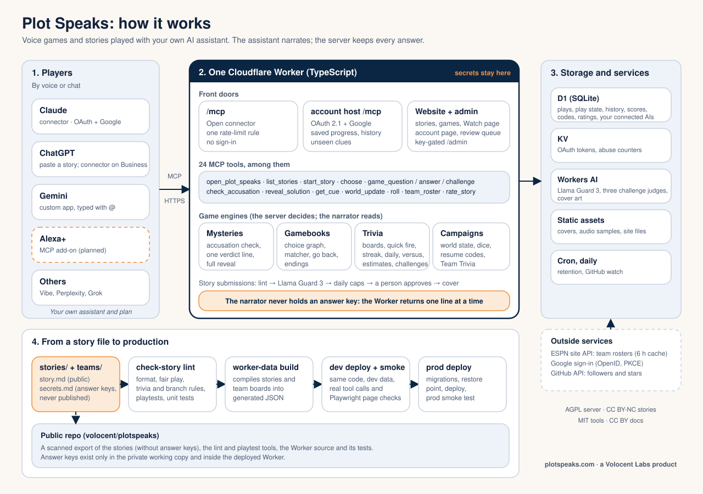

# Plot Speaks

Interactive story scripts you play by voice with your own AI assistant: murder mysteries first, fantasy adventures second. One narrator, short spoken turns, built for long drives. A Volocent Labs project.

**Status: early.** Play at **https://plotspeaks.com**: copy a story into a new ChatGPT or Claude chat, or add the Plot Speaks connector (`https://plotspeaks.com/mcp`, no sign-in), which loads stories and checks accusations so your assistant never holds the answer. The story format, the published stories and the tools that test them are here.

## How it works



The assistant narrates; the server keeps every answer key and decides every verdict. The diagram source is `docs/architecture.svg`.

## What's here

```
stories/        the published stories (murder mysteries, family mysteries, SRD adventures); catalog.json lists them
docs/FORMAT.md  the story format: front matter, GM instructions, scenes, recaps, endings
docs/PLAY.md    how to play a story today
docs/architecture.svg  the technical design of the whole solution
tools/          check-story (lint), playtest (simulated play), solo, worker-data (connector build and matching)
worker/         the Plot Speaks MCP server (Cloudflare Worker)
```

## Run it yourself

    cd worker
    npm install
    npm run data                                   # builds the stories into the Worker
    npx wrangler d1 migrations apply plotspeaks-dev --local
    npx wrangler dev --port 8799                   # http://127.0.0.1:8799

Then point any MCP client at `http://127.0.0.1:8799/mcp` (no sign-in is needed locally), or browse the site at
the same address. Two sample stories with invented answer keys, `stories/sample-harbor-lantern` (a short
mystery) and `stories/sample-trivia`, play end to end from this repository; the published stories' keys stay
private, so those play only on the live server, `https://plotspeaks.com/mcp`. The sign-in host (Google,
OAuth 2.1) needs its own secrets and isn't part of a local run.

## Answer keys are not in this repo

Each story has a private answer key (who did it, and how). It is never published: the connector serves only the one line needed when a player accuses someone. That is why `tools/` and `worker/` refer to `secrets.md` files you won't find here.

## Write a story

Follow `docs/FORMAT.md`, then lint it:

    node tools/check-story/check-story.mjs stories/<your-story>

The lint needs Node 20+ and no installs. It checks the parts of the fair-play rules that a script can check: front matter, chapter recaps, short read-aloud beats, no sound-effect cues, protected names. Whether the mystery is fair still needs a human or an AI reviewer.

## Licenses

- **Stories** (`stories/`): CC BY-NC 4.0. Share and adapt with credit, not commercially. The adventures include SRD 5.2.1 material under CC BY 4.0; see `NOTICE`.
- **Docs** (`docs/`): CC BY 4.0.
- **Tools** (`tools/`): MIT.
- **Server** (`worker/`): AGPL-3.0.

The root `LICENSE` is the AGPL-3.0 text (the repository default and the server's license); each folder's own `LICENSE` governs that folder, and `NOTICE` lists them. © 2026 Volocent Labs LLC.

This repository is generated from a private working copy, so pull requests are read but changes land through the next export.
